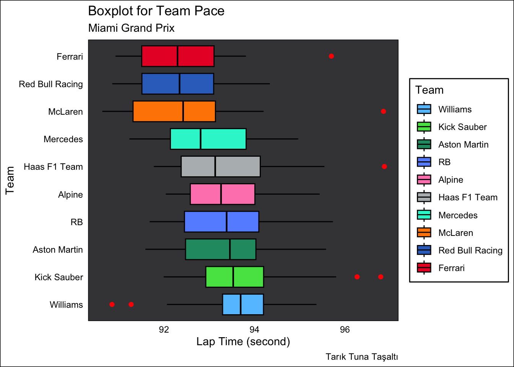
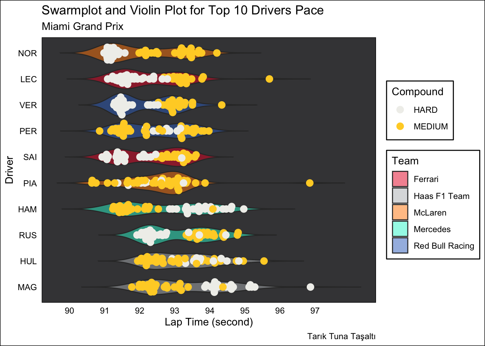
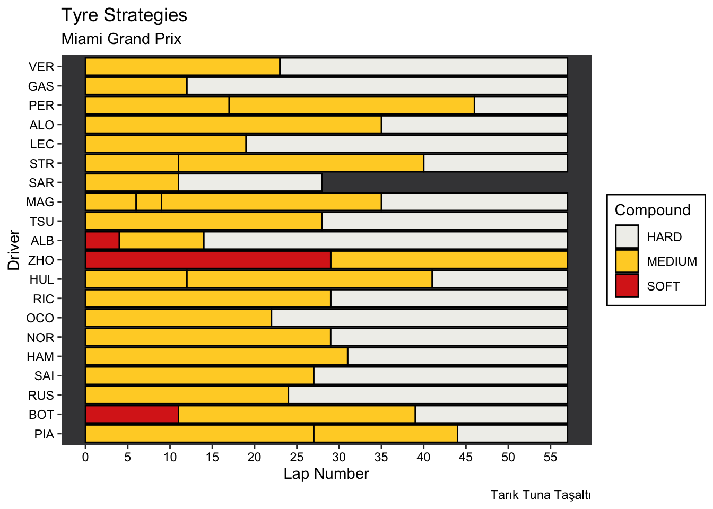
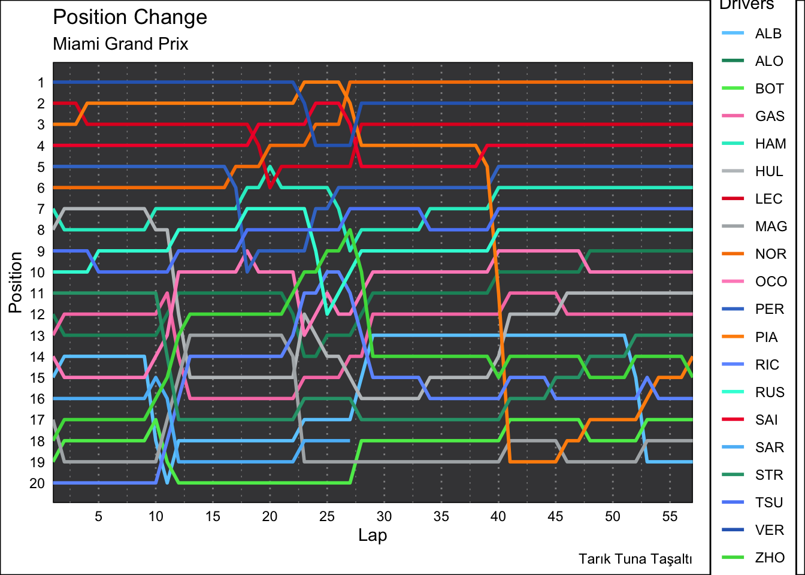
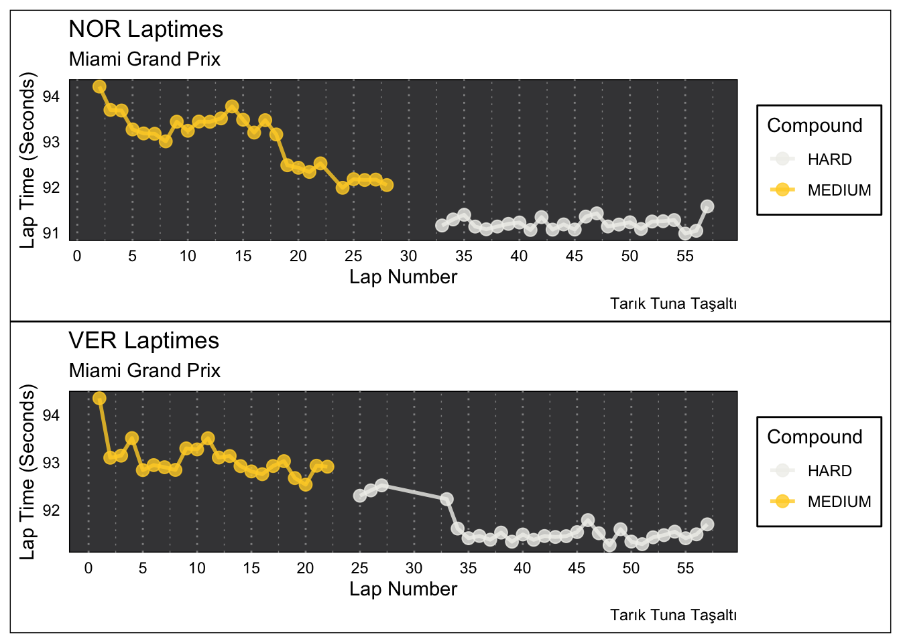

# Formula 1 2024 Race Visualisation

Visual analysis of race pace, tyre strategy and position changes for the first seven races of the 2024 Formula 1 season, with an interactive Shiny app to explore any of these races.

**[Open the app in your browser](https://ttasalti.github.io/f1-2024-race-visualisation/)**. It runs with Shinylive (R compiled to WebAssembly), so nothing needs to be installed; the first load takes a little while.

Final project for Exploratory Data Analysis and Data Visualisation (M.Sc. Data Science, Dokuz Eylül University, spring 2024). Lap data comes from the FastF1 Python package and the plots are made in R with ggplot2. Section headings and comments in the code are in Turkish.

My undergraduate thesis was a Formula 1 lap time simulator: [f1-lap-time-simulator](https://github.com/ttasalti/f1-lap-time-simulator).

All figures below are for the 2024 Miami Grand Prix.

## Race pace by team

Lap time distribution per team, using only representative laps (FastF1 "quick laps": laps within 107% of the fastest lap, which leaves out slow laps such as pit and safety car laps).

## Race pace by driver and tyre

Every lap of the top ten drivers, coloured by tyre compound, over a violin of the driver's lap time distribution.

## Tyre strategies

Stint lengths and compounds for every driver.

## Position changes

Each driver's position on every lap.

## Lap times through the race

Lap times of two drivers, split by stint and coloured by compound.

## Interactive app

`f1_analysis.Rmd` ends with a Shiny app, also saved on its own as `app/app.R` and [published here](https://ttasalti.github.io/f1-2024-race-visualisation/). Choose one of the seven races and a plot type (team boxplot, driver boxplot, swarm and violin plot, strategy plot, position plot, or lap times of a chosen driver) and the plot is drawn for that race.

## Files

| File | What |
|---|---|
| `csv_download.ipynb` | Downloads race laps for rounds 1 to 7 of 2024 with FastF1 (Python) |
| `2024_0X_all.csv` | All laps of round X |
| `2024_0X_quick.csv` | Representative laps only (`pick_quicklaps`) |
| `f1_analysis.Rmd` | Plot functions, the Miami example and the Shiny app (R) |
| `app/app.R` | The Shiny app on its own, deployed to GitHub Pages with Shinylive by `.github/workflows/deploy-app.yml` |
| `quick_laps_plot.ipynb` | The same plots in an R notebook, with outputs |
| `figures/` | Plots shown above |

Rounds 1 to 7 are Bahrain, Saudi Arabia, Australia, Japan, China, Miami and Emilia Romagna.

## Running

Python with `fastf1` and `pandas` to download the data again (the CSV files are already included). R with `ggplot2`, `dplyr`, `readr`, `stringr`, `ggbeeswarm`, `shiny` and `patchwork`. Open `f1_analysis.Rmd` in RStudio with the repository folder as the working directory and knit it, or start the app with `shiny::runApp("app")`.
